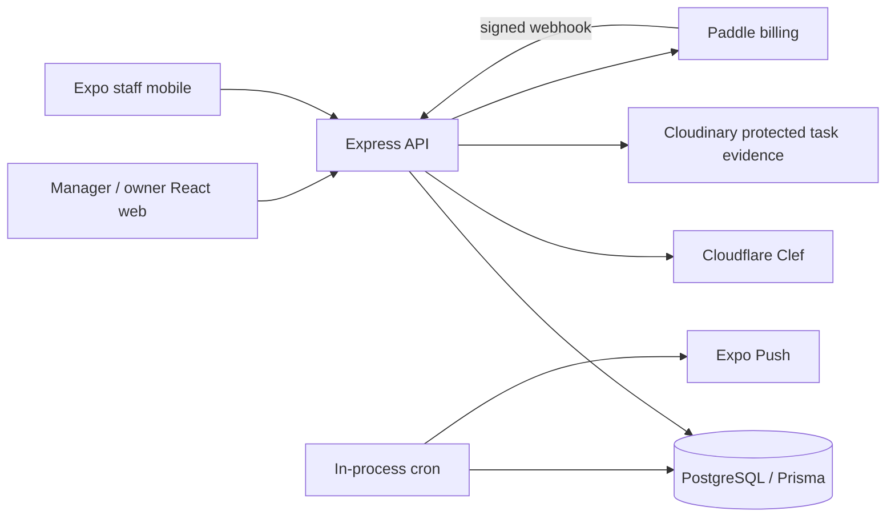

# Hygene Ops project analysis

Review date: 2026-10-19, Asia/Karachi. This describes the source in this directory, not a certified deployed release.

## Assessment

Hygene Ops is a substantial multi-tenant cleaning-operations application. It combines workforce attendance, location and inventory management, scheduling, assignment, guided task photography, AI-assisted review, staff performance reporting, subscriptions, and native phone alerts.

Its strongest engineering is in evidence authorization, immutable task snapshots, transactional decisions, tenant/location boundaries, and tests for concurrent changes. Its largest current weaknesses are inconsistent historical documentation, failing legacy integration suites still required by CI, incomplete container billing configuration, attendance-media privacy, and database round-trip overhead.

The operational features have meaningful automated coverage. The repository does not establish real-world cleanliness accuracy, current physical-device reliability, or production deployment readiness. All 707 unit tests passed during this review; three integration commands failed.

## Scope and method

Inspected the active applications, database schema and migrations, routes, controllers, services, frontend routing/state/data access, mobile capture/auth/native boundaries, deployment workflows, tests, and product/design/implementation records. Traced the current photo flow against historical descriptions. Ran local checks and integration tests in a newly initialized PostgreSQL cluster, never the configured application database.

Generated dependencies, compiled bundles, historical APK contents, and every pixel of existing screenshots were not individually audited. Hidden backup directories were inventoried as historical copies, not treated as the active implementation. One backup `var` directory was unreadable. No secret environment values were printed or used to call live vendors. No real push, payment, Cloudinary upload, AI call, deployment, application migration, or physical-device test was performed.

Starting Git state contained only the untracked `test-staff-20.csv`. Application source was unchanged by this review. Tests/builds produced local generated artifacts. This report is local: the existing broad `*.md` ignore rule also ignores this filename unless an exception or explicit add is used.

## Directory map and size

| Path | Responsibility |
| --- | --- |
| `backend/` | Express 5 API, business services, Prisma/PostgreSQL, cron jobs, verification tooling and tests |
| `frontend/` | React 19 manager/owner web application, public marketing, onboarding and billing |
| `frontend-mobile/` | Expo 54 / React Native 0.81 staff application, native camera/quality/tracking modules, APK artifacts |
| `docs/` | Product plans, implementation records, validation reports, screenshots and historical evidence |
| `.github/workflows/` | CI, Android testing APK, image publishing and manual Compose deployment |
| `PRODUCT.md`, `DESIGN.md` | Audience, workflow and UI conventions |
| `PROJECT_CONTEXT.md` | Consolidated but partly superseded project history |
| `FYP_ML_DISCUSSION.md` | Earlier ML research proposal; not the active inference architecture |
| `.maps-original-backend/`, `.maps-original-frontend/` | Historical map-related copies |
| `.notifications-original-frontend-mobile/` | Historical mobile copy |
| `screenshots/` | Additional visual artifacts |
| `test-staff-20.csv` | Untracked 20-row staff fixture with name/email/phone/password columns; no bulk staff importer was found in the inspected create flow |

Inventory: 827 tracked files; 205 backend TypeScript files, 156 web TypeScript/TSX files, 84 mobile TypeScript/TSX files, 41 Prisma models, 22 enums, and 17 SQL migrations. Backend source includes 64 unit-test files. `docs/` contains 54 Markdown files locally, while only 31 documents under `docs/` are tracked.

Approximate local sizes, including dependencies and generated outputs: backend 507 MB, frontend 394 MB, mobile 3.0 GB, docs 13 MB. Hidden backups add roughly 3.3 GB. The mobile build-output directory contains many historical APKs, ranging from about 54 MB to 177 MB. These disk sizes are not source-code or Git repository sizes.

The root package is a Heroku backend launcher, not a workspace manager. Each application has its own package file, lockfile and dependency installation. Root Node target is 20.x; containers and CI use Node 22; this review ran on installed Node 24.14.1.

## Architecture

The backend is a modular monolith: routes call controllers or services, which use Prisma and explicit transactions. Verification is a large domain within this process. Current staff photo processing is synchronous in the upload request. Retained verification job/worker helpers are historical code; there is no active separate verification worker service in the current Compose files or package scripts. Notification delivery still uses a background polling worker invoked by API cron; these are different subsystems.

Web route definitions are in `frontend/src/main.tsx`; `App.tsx` restores authentication and defines guards. Redux stores web auth, TanStack Query owns server data, React Router owns navigation, and Axios handles cookies and refresh. Workspace pages are lazy loaded. Tailwind 4, Radix components, forms, charts, Google Maps and QR rendering support the manager interface.

Mobile uses a native stack plus My day, Tasks, and Help & account bottom tabs. TanStack Query shares the task feed between Home and Tasks. Native credentials migrate into SecureStore; web credentials use AsyncStorage. Requests bind to the active company/account to prevent an old asynchronous operation from writing into a new login.

## Users and feature inventory

### Company owners / administrators

- Company signup and administrator creation, cookie authentication, refresh and logout.
- Subscription onboarding and plan/usage display; Paddle checkout integration, mirrored billing records and customer portal.
- Location creation/editing, coordinates, geofence radius, timezone, map configuration and manager location assignments.
- Staff creation, shifts, placement, attendance/history, performance reporting, and manager-account administration.
- Operational overview, daily task/staff records, trends, location comparison and review queue.

### Location managers

- Company and assigned-location scope, enforced by backend access helpers rather than only UI filters.
- Inline area-template and fixture configuration under the location workspace.
- Daily or one-time cleaning schedules, designated workers, weekly actual/planned schedule reads and task-specific QR display/printing.
- Attendance, assignment and task progress review.
- Protected photo inspection and audited evidence decisions; review closure with an optional staff performance issue.

### Staff

- Staff-only login, saved session and configurable server address.
- Selfie/GPS attendance check-in and checkout.
- Paginated current-day and unfinished task feed; current totals rather than totals based on one loaded page.
- Task QR scan to start cleaning; a fresh task QR scan to enter the photo workflow.
- Guided required fixture/view capture, local quality checks, native monotonic clock, bounded capture time, server validation and manual retry/result reconciliation.
- Explicit work submission; manager verification remains a separate outcome.
- English/Urdu and RTL presentation, persistent language choice and native phone alerts.
- Current source intentionally has no staff inbox screen, Listen control, persistent photo queue or occupied-room reporting control. Backend notification inbox APIs remain available.

### Plans implemented in backend policy

| Plan | Locations | Staff | Managers including admin | Manager access / automatic assignment and reassignment |
| --- | ---: | ---: | ---: | --- |
| Starter | 1 | 3 | 1 | Disabled |
| Pro | 5 | 25 | 3 | Enabled |
| Enterprise, internal enum `ADVANCED` | 20 | 200 | 20 | Enabled |

Inventory verification is enabled as a plan capability on every plan. Paid-access checks are implemented in the subscription service, but feature availability is not itself evidence that the configured deployment has billing credentials or a qualified AI release.

## Data model and important contracts

The hierarchy is Company → Location → Area → AreaItem. Managers can have multiple ManagerLocation assignments; staff belong to a company and optionally a location. Attendance preserves expected shift windows and actual check-in/out.

TaskTemplate is the schedule, TaskInstance is an occurrence, and TaskAssignment retains assignment history. Generated occurrences snapshot area/item names, types, instructions, required views, rubrics and policy into TaskVerificationItem and TaskEvidenceRequirement. Changing the area later must not rewrite obligations for an existing occurrence. Template/date uniqueness, transactions, SQL constraints and immutability triggers support this contract.

CaptureSession, CaptureSlot and VerificationAttempt bind authorization and capture identity. EvidenceAsset records storage/hash metadata. VerificationException, VerificationIssue, VerificationDecision, ExceptionEvent and read receipts record manager work. VerificationRequest provides operation/request idempotency. Legacy image/submission and verification-job models remain for old data and regression coverage.

Paddle customer/subscription/transaction/event models mirror billing. StaffNotification, StaffPushDevice and StaffPushDelivery support durable notification events and delivery. DeletedMedia is a cleanup outbox.

Important distinction: submission, verification and review closure are separate facts. `staffSubmittedAt` can make operational/staff presentation show Completed while the raw task still awaits verification. `RESOLVE_REVIEW` closes review work without fabricating accepted photos or verified completion. The review-closure integration explicitly tests this distinction.

## Scheduling, attendance and assignment

Daily generation polls every 90 seconds; one-time generation runs periodically; startup runs catch-up generation. Task status, reassignment, attendance status, media deletion and staff notifications run in API cron modules. These are process-side effects of importing the API, not independently managed services.

Schedules support `DAILY` and `ONCE`, effective dates, optional recurrence end, shift windows, one area, and all/subset inventory. Current schedule creation can create today's occurrence and assignment atomically. Future weekly preview entries do not have a task QR until a real TaskInstance exists.

Assignment considers active staff, location, shift coverage, attendance and workload. Automatic assignment/reassignment is plan gated. Assignment epochs and current-assignment checks prevent stale capture authority from receiving ordinary credit. Tests cover overnight/timezone boundaries and deletion races.

Attendance has a 30-minute early check-in window, 15-minute late grace and 30-minute minimum before checkout. It uses haversine distance with up to 200 m of reported accuracy added to the configured radius. Task start uses a separate five-minute early/late policy; notification missing-check-in grace defaults to ten minutes. These are different settings, not a single global grace period.

Selfie capture is not facial identity verification. Reported GPS and possession of a QR are plausibility/authorization evidence, not independently trusted proof of physical presence.

## Current photo workflow

1. An authorized owner or scoped manager obtains `GET /api/task-instance/:taskId/qr`. The HMAC payload binds the exact task, area and current area signing authority. It is stable for an unchanged task, differs between task instances and rejects shared-area, fixture, modified and wrong-task codes.
2. Staff start their assigned task using the task QR. Backend validates current assignment, setup, attendance and start window under a transaction.
3. Staff scan again to open/renew photo authority. Session validation binds task, worker, assignment epoch, device, boot clock, reported location and capture/upload deadlines.
4. The server activates sequential photo slots. A default per-item budget is 90 seconds, with task/session policy bounds. New sessions currently require no entrance/layout context photograph; legacy malformed policies have conservative fallback handling, and authorized migration helpers retire old context obligations.
5. The camera takes a photo. Native quality code estimates brightness/blur/clipping and dimensions; the phone resizes to 1,800 pixels on the longest side and encodes JPEG. The current screen holds a temporary file.
6. Multipart upload commits capture ID, slot/nonce, byte hash and clock metadata. Server reservation checks account, assignment, generations, device, timing and rate limits.
7. `directPhoto.service.ts` claims a bounded processing token, inspects the image and calls `BufferedClefProvider` directly. Its historical class name does not mean this request uses buffered processing.
8. One model request assesses object category, required visible parts, visible cleanliness and screen recapture. The current `photo-categories-v7` adapter follows selected categories; diagnostic confidence does not override a selected category.
9. Wrong object, missing required surfaces, screen recapture and quality problems request a new photo. Clearly dirty required surfaces request cleaning. Ambiguity requires review. CLEAN still requires separate qualified automatic-acceptance release authorization; otherwise it becomes review-required.
10. Retained clean/reviewable results receive authenticated original and sanitized review uploads before successful publication. Rejected dirty/retake results keep metadata but no Cloudinary image. The current path does not run a privacy classifier or exact-fixture identity classifier. `NOT_REQUIRED` is not a passed privacy assessment.
11. A failed request leaves explicit Upload again / Check result choices. A lookup by capture ID reconciles lost successful responses. Assessment caching is evaluator-version-bound so a storage retry can reuse a completed assessment.
12. Required photos must be received and checked before explicit staff submission. Final verification checks required evidence, assignment, presence/context and blocking issues. Manager acceptance/waiver is audited and can result in Completed with exceptions.

Current presets include Indian/squat toilet, Western toilet, retained generic toilet, sink, mirror, bin and floor. Indian and Western configurations have different required surfaces/view counts. Optional standard photos are guidance rather than evidence or similarity baselines; they have their own privacy-screening workflow.

There is no persistent SQLCipher photo queue, background upload synchronizer or active verification-job dispatch in this path. Leaving the screen removes its tracked temporary picture; OS force-kill cleanup was not physically verified. Old helper types and queue functions remain and must not be mistaken for active offline support.

## Evidence security and lifecycle

Positive controls verified in source/tests:

- JWT role is checked against the current database role, including active account/company checks in authenticated access.
- Verification helpers recheck tenant, location and current assignment, including during locked mutations.
- Signed task QR and slot nonces, hash commitments, request IDs and generations prevent several stale/replayed-operation classes.
- Protected task media is uploaded with authenticated delivery and served through an authorized API, with private/no-store and nosniff headers.
- Original task evidence requires administrator access. Historical held media has constrained manager review and audited access.
- Manager decisions use expected versions, task/case locking and idempotency records.
- Deletion, schedule removal and archive are distinct. Retention guards preserve verification history; schedule deletion revokes authority and prevents regeneration without silently rewriting past work.
- Notification triggers create task events in the same transaction as task writes. Delivery uses leases/retries/receipts, and device registrations bind to staff sessions.

These controls do not establish unique physical fixture identity. The active adapter checks category/view, has no current spatial capture, and does not perform the old duplicate-pipeline lookup before publication. It records hashes but does not provide the historical pipeline's complete originality/identity guarantee. Native-app version headers are compatibility controls, not device attestation.

## Findings and priorities

### P1 — CI requires integration suites that currently fail

Reproduced in fresh isolated PostgreSQL databases:

| Command | Failure |
| --- | --- |
| `test:verification:lifecycle` | `verification.lifecycle.integration.ts:431` expects EXTEND_WINDOW success; `exception.service.ts:460` now rejects photo-request actions with HTTP 410 |
| `test:verification:buffered` | `bufferedPhoto.integration.ts:102` expects historical correction wording containing “Clean the basin”; current feedback does not satisfy it |
| `test:verification:integration` | `verification.integration.ts:270` expects three slots; current context-free task has two |

CI explicitly runs lifecycle and buffered integration; Android workflow also runs lifecycle. Thus green unit tests and builds do not imply green repository CI. The legacy monolithic suite passes multiple earlier sections but does not finish.

Action: update legacy expectations around the approved current workflow, retain meaningful invariants, and separate genuinely retired-pipeline coverage from active release requirements. Do not restore removed behavior merely to satisfy stale tests.

### P1 — Published container configuration omits required Paddle settings

Backend billing requires `PADDLE_ENVIRONMENT`, `PADDLE_API_KEY` and `PADDLE_WEBHOOK_SECRET` in `backend/src/config/paddle.ts`. Neither Compose file supplies them. Backend images do not copy `.env`, so host `.env` values are not automatically container variables.

Frontend billing requires `VITE_PADDLE_ENVIRONMENT` and `VITE_PADDLE_CLIENT_TOKEN`. `frontend/.dockerignore` excludes `.env`; its Dockerfile accepts only the API URL as a build argument, and image publishing passes only that value. Consequently, the checked-in image build has no normal mechanism to initialize Paddle.js with the required configuration. The backend portal and webhook likewise lack their required settings in the supplied Compose topology.

Action: wire public frontend Paddle settings into the build, private server settings into runtime environment, and document sandbox/production configuration. Validate a sandbox flow before production. This is a source/config finding; no deployed billing endpoint was exercised.

### P1 — Attendance selfies do not receive the protection used for task evidence

`attendance.controller.ts:234` and `:350` call `uploadSingleImage`; `utils/cloudinary.ts:67` sets folder and image type but no authenticated delivery. Attendance stores `secure_url` directly, while task evidence explicitly uses authenticated Cloudinary objects and authorized reads. HTTPS in a `secure_url` is not the application's task-evidence authorization model.

Attendance debug logs also include precise reported coordinates and the updated attendance record. Concurrent or rejected check-in attempts can upload before the conditional attendance write, leaving media without a matching successful attendance update.

Action: move attendance images to authenticated delivery and scoped reads, remove unnecessary location/record logging, and account for upload/write-failure cleanup. Actual Cloudinary account-wide restrictions were not tested, so public accessibility of a specific existing photo is not asserted.

### P2 — Plan limits are vulnerable to concurrent creation

`subscription.service.ts:132` counts active resources and checks limits; location/staff/manager controllers create afterward without a shared quota lock. The limit check and insertion are not one serialized operation.

A controlled interleaving of two real location-controller calls against an isolated Starter company forced both count reads to finish before insertion. Both calls succeeded, leaving two active locations despite the limit of one. An initial uncontrolled run admitted only one; the bug depends on timing.

Action: lock the company/quota scope while checking and creating, using one transaction. Cover location, staff and manager creation plus relevant reactivation paths.

### P2 — Authentication hardening is uneven

The inspected login/signup/refresh routes have no application-level login throttling. Manager refresh lacks the active company/account and compare-and-swap rotation checks present in staff refresh. Manager refresh tokens also lack the staff token's random JWT ID, so same-second generation need not produce a new token. Protected requests still recheck active state, so this is not evidence of a full deactivation bypass.

Action: align manager/staff session invariants, use unique refresh identities and atomic rotation, and add appropriate authentication request limits. Confirm any external gateway controls before assuming they exist.

### P2 — Synchronous photo latency is highly sensitive to database distance

The prior checked-in latency report measured roughly 103–116 SQL calls for upload plus refresh after optimization. Its controlled 100 ms dispatch-delay experiment still took roughly 9–10 seconds. Those are historical synthetic measurements, not this review's phone timings. This review confirmed the same multi-step authorization/reservation/claim/persistence/publication/manifest architecture.

Action: measure stages from the actual API host, colocate API/database where appropriate, and consolidate repeated reads while preserving transactional checks. Check proxy timeout budgets: Nginx has no explicit upload-processing read timeout, the mobile upload timeout is 120 seconds, and request ownership is 180 seconds. No production load benchmark was run.

### P2 — No current accuracy evidence establishes automatic approval readiness

The benchmark command returned DATASET_UNAVAILABLE, zero examples, `targetMet: false`, and `autoPassEnabled: false`. The release directory has only its placeholder in the checked-in inventory. Runtime private releases/environment were not inspected.

The active categorical adapter and historical threshold/surface calibration tools use different evaluation contracts. Reconcile them before claiming the release tooling qualifies the current adapter. Do not infer model accuracy from unit fixtures, one live historical example, successful HTTP calls, or synthetic latency.

Action: collect consented independently labelled development/held-out data representative of actual phones, fixtures and ambiguity; measure false-clean and wrong/replayed acceptance, abstention, latency and cost. Keep qualified automatic approval fail-closed until evidence matches the actual pipeline.

### P2 — Documentation is detailed but easy to misread

`PROJECT_CONTEXT.md` starts with the direct-upload supersession notice, but later sections still describe a separate worker, SQLCipher queue, entrance photos, speech and retired actions. Its stated update date precedes later appended changes. `frontend/README.md` is a Vite template; mobile README uses obsolete machine paths. Current direct-upload documentation is locally present but Git-ignored.

Action: create one tracked current setup/architecture guide, clearly archive historical reports, and explicitly mark removed features. Replace blanket Markdown ignoring with intentional private-document rules or targeted exceptions.

### P3 — Maintainability and operational packaging need consolidation

- Capture/session logic and exception routes mix large amounts of domain policy into very dense code. A 33 KB capture service occupies only 178 lines; line count understates its complexity.
- Backend TypeScript strictness helps, but approximately 159 `any` tokens remain in backend source, including tests. There is no backend lint script.
- Legacy and current providers/pipelines share helpers and naming, making active-flow reasoning expensive.
- No API health/readiness endpoint or graceful shutdown handler was found in `app.ts`; Compose only health-checks PostgreSQL. Catch-up runs after the API begins listening.
- Cron work runs in each API process. Several operations have database idempotency/locks, but horizontal scaling still needs deliberate scheduler ownership/load review; duplicate task rows were not observed in the exercised concurrency tests.
- The runtime backend image copies all installed dependencies, including development tooling, and uses the default container user.
- Image publishing runs separately from CI rather than depending on its successful completion.
- Signup creates company and manager in separate writes, so a later failure can leave an orphan workspace.
- Large backup/dependency/APK directories make copying and navigating this folder expensive. Inventory them before any cleanup; they were preserved.

## Validation performed

Logs and temporary scripts: `/tmp/priv-project-analysis/`. PostgreSQL cluster: `/tmp/priv-project-analysis/pgdata`, initialized specifically for this review on loopback port 55519. Integration suites created their own isolated databases. Deletion testing used a separately migrated `priv_analysis_deletion_test` database. The temporary PostgreSQL and browser-test web servers were stopped after validation; their local artifacts remain available.

| Check | Result |
| --- | --- |
| Backend `npm test` | 64 files, 578 tests passed |
| Backend `tsc --noEmit` | Passed; avoided rewriting the running development API's compiled output |
| Web `npm test` | 57 passed |
| Web lint | Passed |
| Web production build | Passed; plugin timing warning |
| Mobile `npm test` | 72 passed |
| Mobile TypeScript | Passed |
| Expo web export to temporary directory | Passed |
| Direct-photo HTTP integration | Passed with synthetic images, real local database/routes, mocked AI/storage |
| Manager operations integration | Passed |
| Staff mobile API integration | Passed |
| Staff notification integration | Passed; mocked push transport |
| Review closure integration | Passed |
| Schedule deletion integration | Passed |
| Permanent deletion integration | Passed after explicit isolated database preparation |
| Lifecycle integration | Failed at removed EXTEND_WINDOW behavior |
| Buffered-photo integration | Failed at historical feedback text assertion |
| Legacy verification integration | Failed at obsolete three-slot assertion |
| Evaluator benchmark | Command succeeded, but reported no dataset and no qualified auto-pass |
| Web area-template/QR browser test | Passed at 1440 px and 390 px, including inline editing/conflict recovery, Urdu, redirects, printing region and overflow assertions |
| Mobile Help/Tasks browser test | Passed at 390 px and 1440 px, including absent retired controls and no inbox polling |
| Controlled quota-concurrency probe | Reproduced two successful location creations against Starter's one-location limit |

Browser tests used real rendered applications with fabricated API responses. They do not establish live full-stack correctness or native camera/OS behavior. Integration migration application used SQL fixtures; this was not a production migration/backup/restore rehearsal. Expected negative tests logged controlled Prisma failures. Several integrations emitted a pg concurrent-query deprecation warning.

## Recommended next work

1. Repair CI's workflow/test contract and add the currently important notification, mobile and review-closure integrations to the appropriate validation path.
2. Complete Docker Paddle configuration and protect attendance media.
3. Serialize resource quotas and align refresh-token behavior.
4. Publish a tracked current architecture/setup/feature guide, with historical reports clearly separated.
5. Measure real API/database/photo latency, then validate the current APK on representative devices and real networks.
6. Qualify AI decisions using a representative held-out dataset before enabling any automatic-approval release.
7. Refactor dense verification modules in small behavior-preserving steps and review cron/deployment readiness before scaling.

## Source reading guide

| Topic | Start here |
| --- | --- |
| Backend bootstrap | `backend/src/app.ts` |
| Schema and database protections | `backend/prisma/schema.prisma`, `backend/prisma/migrations/` |
| Auth and password hashing | `backend/src/middlewares/auth.middleware.ts`, `controllers/common.controller.ts`, `src/prisma/prisma.ts` |
| Plans and billing | `backend/src/services/subscription.service.ts`, `paddleFulfillment.service.ts`, `src/config/paddle.ts` |
| Schedule creation/snapshots | `backend/src/controllers/taskTemplate.controller.ts`, `services/verification-v2/inventorySnapshot.service.ts` |
| Assignment | `backend/src/services/taskAssignment.service.ts`, `templateAssignment.service.ts` |
| Current photo API | `backend/src/routes/verification.route.ts`, `services/verification-v2/directPhoto.service.ts` |
| Capture authority | `captureSession.service.ts`, `sequentialCapture.service.ts`, `qr.service.ts` |
| Model decisions | `bufferedPhoto.provider.ts`, `photoResultPolicy.ts`, `photoDecision.service.ts` |
| Submission/finalization | `staffSubmission.service.ts`, `completion.service.ts` |
| Reviews/performance | `exception.service.ts`, `reviewClosure.service.ts`, `routes/verificationException.route.ts` |
| Task media | `evidence.service.ts`, `media.service.ts`, `routes/evidence.route.ts` |
| Operations/read performance | `managerOperations.service.ts`, `operationsOverviewAggregate.ts`, `services/mobile/staffMobile.service.ts` |
| Notifications | `backend/src/services/staff-notifications/`, notification migrations, mobile `src/notifications/` |
| Web entry/state | `frontend/src/main.tsx`, `App.tsx`, `api/client.ts` |
| Web workflow UI | `frontend/src/pages/Location/`, `Area/`, `Exceptions/`, `Manager/` |
| Mobile capture | `frontend-mobile/src/screens/verification/VerificationScreen.tsx`, `src/verification/api.ts` |
| Mobile auth/network | `frontend-mobile/src/auth/`, `src/api/client.ts` |
| Native boundaries | `frontend-mobile/modules/capture-quality/`, `modules/spatial-tracking/` |
| Current feature changes | `docs/verification/TASK_QR_AREA_TEMPLATE_2026-10-18.md`, `PHOTO_CATEGORIES_2026-10-18.md`, `docs/STAFF_NOTIFICATIONS.md` |

Paths without a root in the verification rows refer to `backend/src/services/verification-v2/`.
